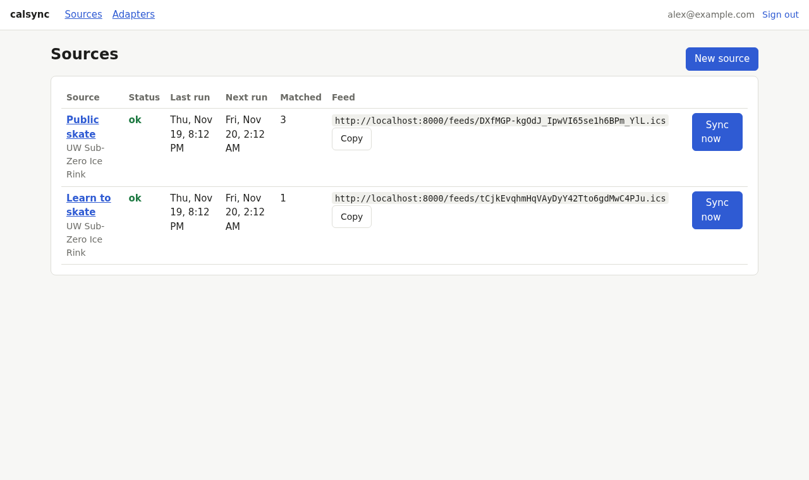
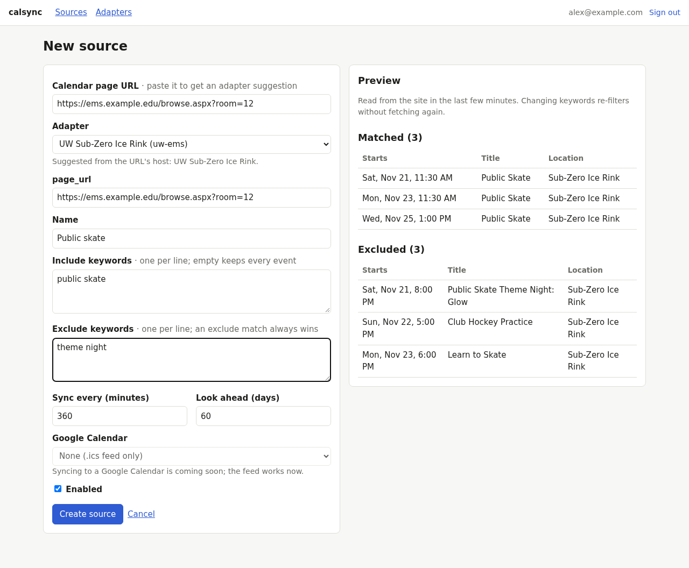
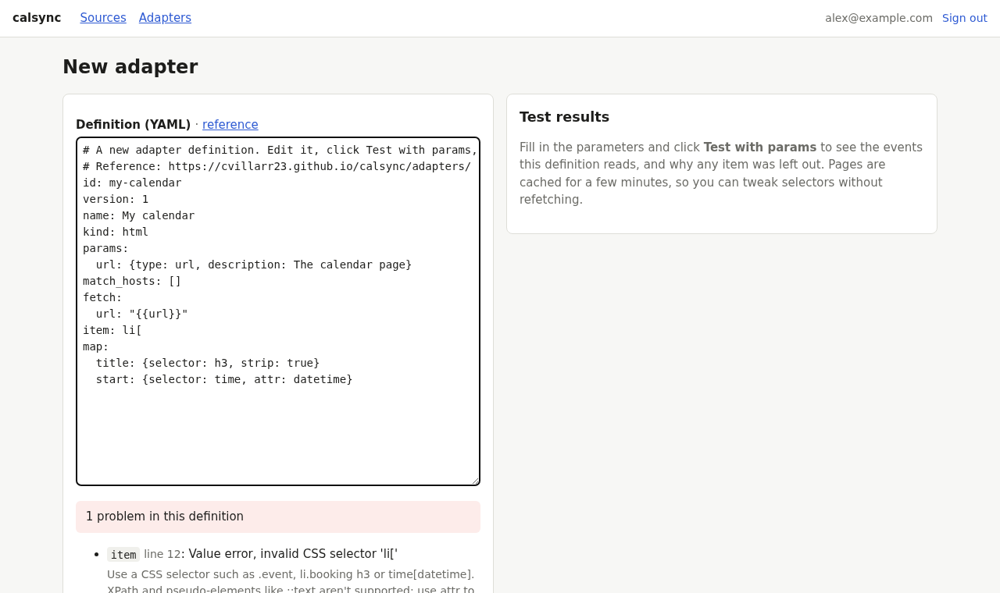
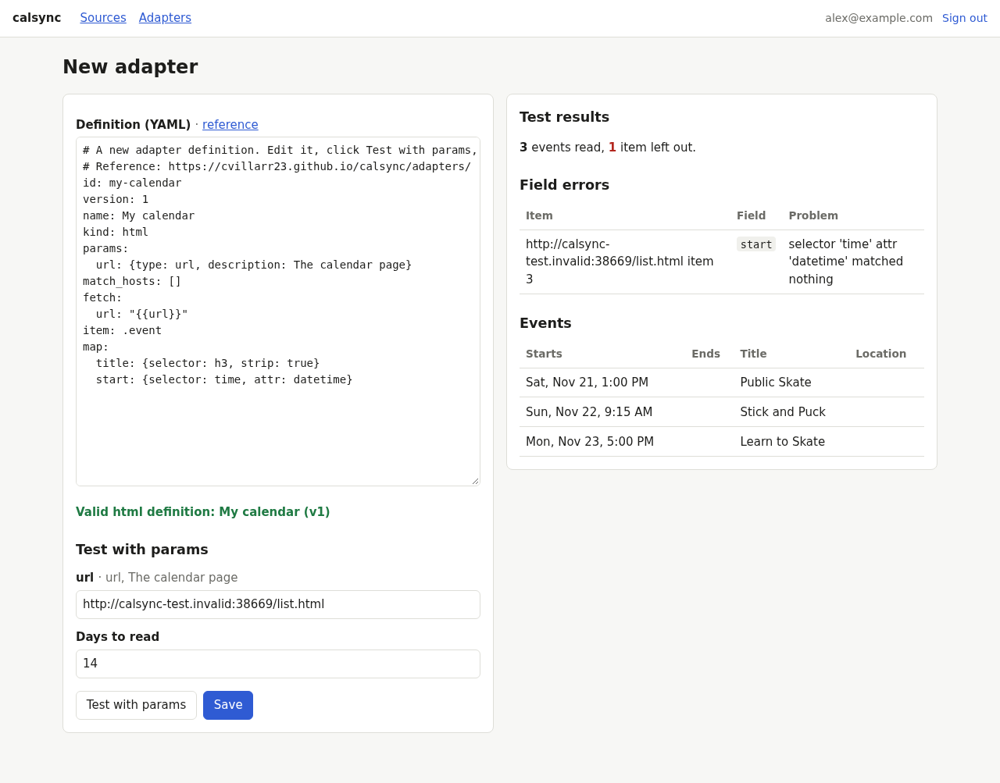

# Using the web UI

Everything in calsync can be set up from the browser: sign in, write or import an adapter, test it against the live site, and add sources that use it.

## Signing in

Open your instance's base URL and sign in with Google. The first time, Google asks you to allow calsync to read your calendar list and manage events. calsync asks for *offline* access, so it gets a refresh token it can use to sync while you're away. The token is encrypted with `CALSYNC_TOKEN_ENC_KEY` before it is stored.

If you sign in and Google doesn't send a refresh token (for example, because you allowed calsync before and the grant was reset), calsync sends you through the consent screen once more to get one.

Only the accounts in `CALSYNC_ALLOWED_EMAILS` can sign in. Any other account is turned away after Google's sign-in, and no session is created. An account whose email Google hasn't verified is always turned away. See [Configuration](configuration.md).

Your session lasts 30 days. **Sign out** in the top-right ends it; your sources keep syncing.

## Sources

The **Sources** page lists each source with:

- **Status**: `ok`, `error` with the error and a hint about what to do, or `never run`.
- **Last run** and **Next run**. The next run is the source's interval after the last one, and longer while the site keeps failing; see [Scheduling](api.md#scheduling). A paused source has no next run.
- **Matched**: how many upcoming events pass the source's filters right now.
- **Feed**: the source's `.ics` URL, with a **Copy** button. Anyone with this URL can read the feed; see [Calendar feeds](feeds.md).
- **Sync now** runs the source immediately and updates its row.

### Adding a source

1. Paste the calendar page's URL into **Calendar page URL**. If an adapter lists that host in its `match_hosts`, it is selected for you and its URL parameter is filled in.
2. Pick the **Adapter** if none was suggested, and fill in its parameters. Parameters with a default can be left blank.
3. Add **Include keywords** and **Exclude keywords**, one per line. An event is kept when its title contains any include keyword, unless it contains an exclude keyword. With no include keywords, every event is kept. Matching ignores case and extra spaces.
4. Set how often to sync (at least `CALSYNC_MIN_INTERVAL_MIN` minutes) and how many days ahead to read.

The **Preview** on the right updates as you type. It shows which events would be synced (**Matched**) and which the filters drop (**Excluded**). The adapter runs once; changing keywords only re-filters what it read, so you can try keywords freely. Changing the adapter, its parameters or the lookahead runs it again. Results are kept for about five minutes.

Syncing to a Google Calendar isn't available yet. Every source is served as an `.ics` feed.

## Adapters

The **Adapters** page lists the built-in adapters and your own. Your adapters are private to your account.

### Writing an adapter

**New adapter** opens the editor with a small working `html` definition to start from. Edit the YAML on the left; it is checked as you type, and each problem is shown with its field path, the line it's on, and a hint.

Under **Test with params**, fill in the parameters the definition declares, then click **Test with params**. calsync runs the definition against the live site, without saving anything, and shows:

- every event it read;
- every item it had to leave out, with the field that failed and why.

Fetched pages are cached for about five minutes, so you can adjust selectors and test again without hitting the site each time. **Save** stores the definition exactly as you wrote it, comments included. A source can use it as soon as it's saved.

Built-in adapters open read-only. **Copy as new** opens the editor with a copy under a new id.

### Export and import

**Export YAML** downloads a definition as `<id>.yaml`. To use a definition someone shared with you, click **Import** on the Adapters page and paste it, as YAML or JSON.

## Troubleshooting

### "The adapter returned no events, so nothing was removed"

A sync that reads no events at all, while future events are stored, is treated as a failure, and calsync keeps the stored events. An error page, a changed URL or a site redesign all look like an empty schedule, and deleting everything would be the wrong response to them. Open the adapter, use **Test with params** with the source's parameters, and see what the site returns now. See [Calendar feeds](feeds.md).

### Step-order errors

A pipeline runs its steps top to bottom. `items` must be the last step, because it hands each record to `map`. `paginate` repeats the steps after it once per date, so an `http` step must follow it. A typical order is `http → extract → paginate → http → extract → items`. The error's field path, such as `steps.5`, counts steps from 0. See [Step order](adapters/pipeline.md#step-order).

### JSONPath and CSS errors

- **`invalid JSONPath`**: a JSONPath starts at the document root, for example `$.d` or `$.MonthlyBookingResults[*]`. Check brackets and quotes.
- **`invalid CSS selector`**: use plain CSS such as `.event`, `li.booking h3` or `time[datetime]`. XPath and pseudo-elements like `::text` aren't supported; read an attribute with `attr`.

These are reported when you save, at the exact field: for example `map.title.jsonpath` or `steps.1.extract.css`.

### "No event could be read"

The adapter found items, but couldn't read a required field (`title`, `start`, or a mapped `date`) from any of them. **Test with params** lists each item with the field and the reason.

### "resolves to non-public address"

calsync refuses to fetch private, loopback and link-local addresses. Set `CALSYNC_FETCH_ALLOW_PRIVATE` only if the calendar really is on your own network. See [Safety limits](adapters/concepts.md#safety-limits).
